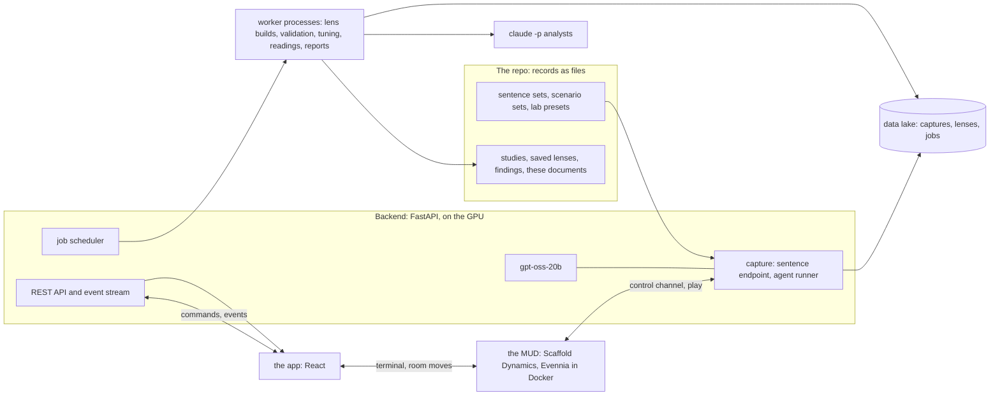

# OpenLLMRI: plan and architecture

Related: docs/design/requirements.yaml (the numbered requirements), docs/design/design.md (the
design and requirements), docs/pages/build.py (the pages), docs/pages/check.py (the page checks)

**Status:** drafted on 2026-10-11, for Andrew's review section by section. This document holds the
order of work and each phase's plan, which Andrew approves here [DOC-9], and how the software is
built. What the software is for, and its requirements, are in
[the design-and-requirements document](design.md#how-to-use).
- **Requirement ids** in brackets are chips on the page; pointing at one shows it in full.
- **Questions** are numbered in the order they were asked (L1, L2 and so on); in charts, L0 to L23
  are layers instead.
- **Technical words** are explained under [Terms](plan.md#terms), near the end.

## Where we are {#where-we-are}

**Now (2026-10-11): the two documents** [DOC-3, ORDER-5]. The requirements list, both documents,
their pages and the checks before Andrew reads are done; his review, section by section, is next.
The steps are under [The two documents](plan.md#phase-documents). After the review, the old
DESIGN.md and `one-mud.md` become pointers (each keeps only a short note naming the documents that
replaced it). Until then the old DESIGN.md remains the source of truth.

**Beside it: the animal ontology study** [ORDER-15]: the 524 names labelled by hand in the nine
ways, then the capture, the lens and the analyses, mostly while Andrew reviews the documents.

**Next: the new app, room by room** ([its plan](plan.md#the-new-app), for Andrew's yes: L31), then
slice 2 (capture and jobs).

**What needs Andrew:**
- **L30,** the new app's rooms: a card among [the design's decisions](design.md#decisions-needed);
- **L31,** the new app's plan, and **L32,** the superseded documents to delete, with a verdict for
  each: cards among [this document's decisions](plan.md#decisions-needed) [WAY-11];
- the two documents' review, section by section, through the boxes under each section.

## Decisions needed {#decisions-needed}

### L31. The new app's plan [Open]

The plan for the new app, room by room, is under [The new app](plan.md#the-new-app). In short:
- the shell and the hub first; then the MUD's new rooms; then the studies room, the observatory,
  the lens workshop, the polysemy lab, the simulator and the library;
- the MUD step changes the MUD's code: the institute gains a room for each app room, and a new
  message lets the app move a player's character;
- each room is walked against the checklist of every current feature, and the current app is then
  removed with a deletion list, for your yes.

Claude's main choice: the rooms are built as new pages inside today's frontend, not as a separate
app, so the chart code carries over with its tests. Approving the plan lets this work start,
including the MUD changes, once you have reviewed the two documents [WAY-1].

- ( ) Approve the plan (recommended)
- ( ) Change it (say what in the note)
- ( ) Other

### L32. Superseded documents [Open]

These documents describe designs that were replaced. Git keeps every one, so deleting them loses
nothing, and documents show the current design only [WAY-5]. Some carry a note at the top naming
what replaced them; three carry none. Claude's verdict on each:
- **`LLMud/VISION.md`** (written in April; a note from 2026-10-08 points to the old DESIGN.md),
  **`LLMud/AI_SYSTEM_DESIGN.md`, `INSTITUTION_DESIGN.md` and `WORLD_DESIGN.md`** (April; each
  marked a frozen reference since 2026-03-31, pointing to `architecturemud.md`) and
  **`LLMud/examplescenario.md`** (April; no note): the vision and design of the old MUD platform,
  from before lenses. Replaced by the design's [purpose](design.md#purpose) and
  [the MUD](design.md#mud). Not needed.
- **`docs/architecturemud.md`** (April; a note from 2026-10-06 points to `one-mud.md`): the old
  MUD's architecture; that MUD was deleted on 2026-10-07. Replaced by [the MUD](plan.md#the-mud)
  and the design. Not needed; the `/thorough-review` skill only uses its name as an example.
- **`docs/architecturescenarios.md`** (April; no note): the April scenario system. Replaced by the
  staged engine and the scenario library's format (`data/scenarios/README.md`). Not needed.
- **`docs/steeringandscenarios.md`** (April; no note): April's steering through the neurons that
  separated the old clusters, and the scenario designs that became friend/foe v2. Replaced by
  [interventions](design.md#interventions) and the builder; friend/foe v3 is drafted fresh in the
  builder. Not needed.
- **`docs/scratchpad/time_in_the_mri.md` and its review** (2026-10-07; notes from 2026-10-08 point
  to the old DESIGN.md): the time proposal and its review, which Andrew ruled on. Replaced by
  [reading over time](design.md#time). Not needed.

Kept, as still in use: `docs/SOFTWARE_OVERVIEW.md` (its probe-authoring rules), and, after your
review, the old DESIGN.md and `one-mud.md` as pointers.

- ( ) Delete them all (recommended)
- ( ) Keep some (say which in the note)
- ( ) Other

## How we work {#how-we-work}

**The working agreement,** from Andrew's standing rulings:
1. **A plan Andrew has approved and told Claude to start is permission for what it lists, and
   nothing else** [WAY-1]. Source code changes only when Andrew has said code may change;
   sentence sets, research notes, scratchpads and memory are exempt [WAY-2].
2. **Design first, then build** [WAY-3]: a fixed order of work, the same procedure for every
   phase, progress Andrew can see, and a parked list (the [register](plan.md#register)) with an
   owner for every item; no deadlines and no time boxes [WAY-4].
3. **Documents show the current design only:** superseded content is removed, git keeps the
   history, and a decision reaches every document that describes the thing; replaced requirements
   are the exception and stay in the list, marked retired [WAY-5]. Andrew's own words never go
   into the repo [DOC-8].
4. **Nothing of Claude's enters the design as decided without Andrew's yes.** A decision applies
   exactly its own scope, and his examples show the kind of thing he means, not the exact thing to
   build [WAY-6]. The design is a work in progress that his new ideas update [WAY-25].
5. **Claude is a design partner:** real pushback and ideas, never a rationalized choice; a problem is
   said once, plainly, with alternatives, and then his decision stands [WAY-7]. No question he has
   already answered goes to him [WAY-8].
6. **Discussion before change:** a finding comes to Andrew with a concrete proposal, and the change
   follows his ruling [WAY-9]. Clearly right fixes to tooling are Claude's to make and mention;
   design changes, deletions and data decisions are his [WAY-10]. A deletion comes with a verdict
   for each item [WAY-11].
7. **Within approved work, Claude keeps going** through every step, committing at milestones, and
   stops only for a decision Andrew must make or a real blocker [WAY-12]. When he approves without
   reading, Claude thinks every step through by reading the code and data themselves, not by
   pattern [WAY-13]. No approach is chosen for being faster [WAY-14].
8. **Questions go into a page's form,** never the terminal [DOC-12]. Before Andrew reads a document,
   it gets an independent audit of its marks against his words, a readability review and the page
   checks [DOC-10].
9. **Research:** exploratory analysis is first-class [WAY-15]; every result that can be charted gets
   a figure as the work goes [WAY-16].
10. **Writing:** paper prose and these documents are plain technical English, read by a readability
    reviewer first [WAY-17]; infrastructure is explained plainly [WAY-18]; documents can be wrong,
    and Claude raises what it finds rather than following or quietly overriding them [WAY-26].
11. **Operations:**
    - the skills' procedures, copied exactly [WAY-27];
    - a full restart after any code change [WAY-21];
    - Claude agents run through the user's Claude Code login, with any API key kept out of their
      environment [WAY-23];
    - lake data is never deleted without Andrew's OK [WAY-19];
    - commits bundle a unit of work, and pushes happen at shippable points [WAY-20];
    - when Andrew interrupts, Claude stops [WAY-24].

**Claude's own practice, proposed for Andrew's yes:**
- live tests log in with the agent account or throwaway accounts, never as admin [WAY-22];
- a method proposal is tested with today's tools, where they can, before it goes to Andrew for a
  ruling [WAY-28];
- every published number is recomputed from the data at every layer it names [WAY-29].

**Every phase runs the same way:**
1. Andrew approves the phase's plan here.
2. Re-read the plan and the files it names; check the claims it depends on in the code and data
   themselves.
3. Tests first, wherever behaviour changes.
4. Make the change; run the phase's checks and the baseline test suites, and read the output.
5. Commit; push at the points the phase's plan names.
6. Update "Where we are" and the phase's progress.
7. Anything found outside the plan goes on the register, not into the work.

## What Claude understood {#understood}

Claude's reading of Andrew's recent answers, to check against what he meant. On the page, his own
words for each are shown beside it, from the page's private store.

- **The step back (2026-10-10).** The app is rebuilt from the ground up, its approach left to
  Claude, as long as everything it does today comes back, with more of it visual. The MUD's first
  job is running agents in scenarios, alone or with people taking part, and its second is a way to
  move around the app. The reasoning streams are analysed before the agent is asked to use any
  word. And there are to be two documents, each consistent throughout, modelled on Andrew's own
  pages. Claude read the rebuild as new screens over carried-over chart code, so nothing that works
  is thrown away [APP-1, APP-6, MUD-2, TIME-9, DOC-2].
  <!-- words: 2026-10-10 -->
- **The animal set (L16.1, L16.6).** One framing chosen in advance was too narrow. Instead, animals
  are organized in many ways, each animal is labelled in all of them, and the model's states show
  which ways it follows. Claude is also to give the reasons the first study compared descent with
  way of life. Andrew's point that an animal seen for a moment is identified from a few cues Claude
  read as grouping by quick cues (shape, size, covering, where it is met), which became the
  ontology's ways of looks and setting [SET-12, SET-13, SET-14, SET-15].
  <!-- words: L16.1 -->
  <!-- words: L16.6 -->
- **The builder (L22).** One builder for sets and scenarios. For scenarios, it leaves room to try
  several authoring setups and teams of agents until the scenarios meet their criteria. Claude kept
  that to scenarios and asked about sets separately; L29 then allowed teams for sets too
  [BUILD-1, BUILD-2, BUILD-3].
  <!-- words: L22 -->
- **The order of work (L21) and the rooms (L20).** The documents first, then the new app room by
  room until it does everything today's app does, then capture and jobs. Rooms are the app's
  places, moving with the MUD when it is open. Claude read the room-by-room build as one phase with
  a checklist; the studies room among the first rooms is Andrew's L17.1 answer
  [ORDER-5, APP-4, APP-5, STUDY-2].
- **The documents (L24, L26).** Both in the repo, as pages with comments and forms, written from
  numbered requirements, with the plan moved here. Claude read the model of Andrew's own pages as
  their shape, not their content, and kept this repo's rule that his words never enter it
  [DOC-2, DOC-4, DOC-6, DOC-8, DOC-9].

## Phases {#phases}

The order of work is Andrew's [ORDER-1]. A phase is one unit of planned work; a slice is a phase
that adds a usable piece of the software. Each slice ends with a showcase, one striking figure and
a short findings note [ORDER-2]; the two steps before slice 2 end with the documents approved and
the current app retired instead [ORDER-5, ORDER-6]. Claude proposes that studies run beside the
slices whenever today's tools can carry them [ORDER-14].

| # | Phase | State |
|---|---|---|
| 0–9 | One MUD in one repo | done 2026-10-07 |
| 10 | The design | approved 2026-10-08 |
| 10a | Approval housekeeping and the retirements | done 2026-10-08 |
| 10b | Slice 1, the lens core | done 2026-10-08 |
| 10c | Slice 1b, the tuned lens core | done 2026-10-09 |
| 10d | Slice 1c, animals, objects and tuning by hand | done 2026-10-09 |
| 10f | The two documents | **now** |
| — | The animal ontology study | beside 10f |
| — | The new app, room by room | next, plan below (L31) |
| 10e | Slice 2, capture and jobs | after the new app (numbered before 10f, then moved later by L21) |
| — | Slices 3 to 11 | in order, each planned here when reached |

### Done {#done}

- **One MUD in one repo (Phases 0 to 9, 2026-10-04 to 10-07)** [MUD-1, MUD-22, ARCH-1, ARCH-7, ARCH-8]:
  - everything moved to `~/OpenLLMRI` on WSL's disk, with an exact copy of the working
    environment; the captures were curated (six kept sessions) rather than copied wholesale;
  - Winter Survival's MUD was imported with its history and became Scaffold Dynamics, the one MUD,
    with Winter Survival's behaviour only in its own rooms;
  - backend tests and continuous integration were added;
  - the staged scenario engine, the scenario library, the institute (hub, polysemy lab,
    simulator), watching and guests came;
  - capture was proven end to end; the old prototype MUD was retired; Andrew walked it, and the
    branch was merged.
- **The design (Phase 10, 2026-10-07 to 10-08):** the old `docs/DESIGN.md`, built from Andrew's
  words, reviewed part by part and approved, with Claude's final read accepted [DOC-17]; then the
  approval housekeeping and the retirement of the old temporal tools (10a) [DATA-12].
- **Slice 1, the lens core (10b, 2026-10-08)** [ORDER-3]:
  - background jobs; lenses with k per layer, versions and saving;
  - the all-layer Layers view; the lens form; colour that shows mixtures faithfully; expert layout
    and fingerprints;
  - validation with the k profile and the self-check; raw space and mass-mean lenses; node
    details;
  - LLM analysis with checked numbers; the command channel and lens building from the lab; atlas
    nodes and study files;
  - showcase: `docs/studies/lens_core/showcase/`.
- **Slice 1b, the tuned lens core (10c, 2026-10-09)** [ORDER-3, LENS-17, APP-29, APP-30, LENS-45]:
  - tuned lenses; reading other captures through a lens, with lit paths;
  - the 3-D view in the lens's own space; pipelines, hubs and experts in every report;
  - the axes analysis; the single-word lens;
  - showcase: `docs/studies/single_words/showcase/`.
- **Slice 1c, animals, objects and tuning by hand (10d, 2026-10-09)**
  [ORDER-3, SET-4, LENS-18, LENS-20]:
  - split words read at their last token;
  - every UMAP setting in the form, settings per layer, "Rebuild with…", the layer preview,
    comparing lenses; a lens that remembers its hold-out design;
  - the animal and object sets and lenses, with the harm axis;
  - showcase: `docs/studies/animals/showcase/`;
  - afterwards, the read site was tested without code and kept at the last token [SET-6].

### Now: the two documents (10f) {#phase-documents}

**Goal:** the design-and-requirements document and this document, as pages with comments and forms,
written from the numbered requirements, replacing the old DESIGN.md and `one-mud.md`
[DOC-2, DOC-4, DOC-5, DOC-6].

**Why:** the design had grown into one long document whose decisions were hard to trace and whose
plan lived in Claude Code's own file, out of Andrew's sight; he asked for two documents modelled on
his own pages, first in the order of work [DOC-2, DOC-3, DOC-9].

| Step | What | State |
|---|---|---|
| 0 | The requirements list, with a check that every marked passage of the old DESIGN.md maps to an id | done |
| 1 | The design-and-requirements document | done |
| 2 | This document | done |
| 3 | The pages: one build script (index rail, requirement chips, question cards, a box to write in under every section, everything written collected at the end) and the page checks | done |
| 4 | The checks before Andrew reads: three independent audits of the requirements and the documents against his words and the code, two readability reviews, the page checks, and a browser walk of both pages at desktop and phone width | done |
| 5 | Andrew's review, section by section, through the boxes | **now** |
| 6 | After the review: the old DESIGN.md and `one-mud.md` become pointers, and CLAUDE.md points to the new documents; the superseded documents Andrew approves for deletion (L32) are deleted | waiting |

The details (files, scripts, the steps' order) are Claude's, reviewed with the documents [DOC-11].
**Done when** Andrew has reviewed both documents and his boxes are answered; from then on, the
documents are the source of truth.

### Beside it: the animal ontology study {#phase-ontology}

**Goal:** which ways of organizing animals the model's states follow, layer by layer
[SET-15, SET-16]. **Why:** Andrew changed the animal set's framing to many ways [SET-12].

| Step | What |
|---|---|
| S0 | The set `animals_ontology_v1`: the same 524 entries as `animals_kinship_v1`, plus eight new axes, written by hand by Claude in one pass, with its guide (every rule and the borderline cases) [SET-17, SET-28] |
| S1 | Its audit, with the taxonomy checked against each animal's common names [LENS-27] |
| S2 | The capture, with the date pinned to 2026-09-16, so every state equals the first capture's |
| S3 | A lens with whole orders held out; validation, the axes analysis, routes, node details, reports |
| S4 | The three measures (neighbours beyond chance, held out, each way's own share), within each token count, in raw space and the lens's space, with figures [WAY-16] |
| S5 | A findings note, the study's ledger, a figure |

### Next: the new app, room by room {#the-new-app}

**Goal:** the app rebuilt as rooms, doing everything today's app does, with the studies room among
the first; then the current app retires [APP-1, APP-4, APP-5, STUDY-2].

**Why:** Andrew wants more of the app visual and its screens uncrowded, and the rooms make the app
a place to move around, with the MUD when it is open [APP-2, APP-4, MUD-4, ORDER-18].

**How (Claude's proposal):**
- built inside today's frontend as new pages, one per room, beside today's views until they are
  removed; the chart code moves over with its unit tests [ARCH-10];
- design tokens give each room its accent [ARCH-10, ROOM-11];
- a small set of accessible controls (sliders, toggles, folding panels) built on headless
  primitives [ARCH-11];
- the MUD gains a room for each app room, and the app can move the player's character
  [ARCH-12, ROOM-9];
- the rooms themselves are L30's proposal [ROOM-1 to ROOM-14].

| Step | What | Ends with |
|---|---|---|
| 1 | The shell | a page per room; design tokens; the control set; the top bar, the folding terminal, the view's state in the page address and the event stream carried over; the quick-jump box; the hub with its map |
| 2 | The MUD's rooms | the institute's new rooms (observatory, workshop, library, studies room); the message that lets the app move a character; rooms kept in step both ways, with the MUD's integration tests |
| 3 | The studies room | every study from `GET /api/studies`, with its question, sets, captures, lenses, findings, ledger, status and showcase [STUDY-3, STUDY-4] |
| 4 | The observatory | everything in Layers, laid out with folding panels and the details panel [ROOM-3] |
| 5 | The lens workshop | everything in Build [ROOM-4] |
| 6 | The polysemy lab | the observatory preset, opened on entry, capture locked, read-only for visitors [ROOM-6] |
| 7 | The simulator | scenario sets and their scenarios (a small list endpoint), the agent runs captured, the terminal open [ROOM-7] |
| 8 | The library | sentence sets with their guides and audits, scenario sets, captures, saved lenses [ROOM-5] |
| 9 | The walk | every room against the checklist in [The new app's checklist](plan.md#new-app-checklist), with screenshots at desktop and laptop sizes; then Andrew's walk |
| 10 | The retirement | today's views and their components removed, with the deletion list and a verdict per item, for Andrew's yes [ORDER-6, WAY-11] |

**Tests:** the carried-over unit tests keep passing; new unit tests for how the quick-jump box reads
a command and for the room pages; a browser walk per room with screenshots and no console errors;
the MUD's integration tests for keeping rooms in step; backend tests for any new endpoint.

**Andrew reviews:** this plan first (L31); the rooms after step 3 (the shell and the studies room),
step 5 (observatory and workshop) and step 9 (the full walk); then the deletion list.

**Done when** every checklist item works in a room, his walk passes, and the deletion list is
approved and carried out.

**How sure:**

| Claim | Evidence | Certainty |
|---|---|---|
| The charts carry over unchanged | their logic is in pure modules with unit tests (`sankeyOption.ts`, `lighting.ts`, `color/`, `trajectory3d.ts`, `exportFigure.ts`) | 90% |
| Moving rooms works both ways | the MUD's `room_entered` already moves the app; the reverse needs one new message, which the control channel's design allows | 85% |
| Nothing is lost | the checklist is built from every component, then walked | 90% |

**Risks:**
- a full rebuild is large: it goes room by room, each usable, with three review points;
- the library needs the sentence-set endpoints, which today always fail (on the register);
- visual quality could disappoint: design tokens, screenshots and Andrew's walks answer it.

### Then {#then}

Each is planned in detail here when it is reached [DOC-9].
- **Slice 2, capture and jobs** [ORDER-7]. It comes before the builder, which captures each new set
  as a background job. Its draft plan is `docs/scratchpad/slice_2_plan.md`; its frontend parts move
  into the new app. It holds:
  - the capture recipe and per-run token ids [DATA-10];
  - the GPU job queue inside the backend [DATA-8];
  - more token positions, and states after generation starts, for sentence sets [DATA-7];
  - agent-run items keeping the observation [DATA-9];
  - the MUD's network address entered in the app [MUD-19];
  - the leftovers removed [DATA-13];
  - the first four method changes [LENS-26].
- **Slice 3, the builder for sets and scenarios** [ORDER-8, BUILD-1 to BUILD-7]:
  - its audits and critic [SET-30, LLM-9];
  - then the starter lens catalogue [GOAL-15];
  - later, editing studies' designs [BUILD-4].
- **Slice 4, agents in scenarios** [ORDER-9, ORDER-10]. Claude proposes starting with the reasoning
  streams' frequent words [TIME-9], then friend/foe v3 drafted in the builder, how people take part
  in each scenario [MUD-3], and the MUD workspace [ORDER-19]. The rest of the slice:
  - lens kits and keywords [LENS-37 to LENS-41];
  - the scan [TIME-5];
  - replay [WATCH-7, MUD-8];
  - scripted runs, and Watch [WATCH-1 to WATCH-15];
  - node dynamics from agent runs [ATLAS-3];
  - tokens × layers heatmaps and per-run alerts [APP-32, WATCH-12];
  - one published game-probe result replicated [INT-7];
  - the experiments listed under [Open questions](design.md#open-questions) [TIME-17].
- **Slice 5, time on sentence runs** [ORDER-11]:
  - checked against the paper's tank results first [TIME-18];
  - in Study, with presence and position, references and bands [TIME-13 to TIME-15];
  - depth heatmaps and the temporal Sankey [APP-32, STUDY-5, STUDY-6].
- **Slice 6, the atlas's second version** [ORDER-11]:
  - expert and route catalogues across every capture [ATLAS-1, ATLAS-2];
  - node dynamics from sentence runs [ATLAS-3];
  - cross-lens reports [LLM-14]; overlaps by cross-reading [ATLAS-9];
  - the published atlas [ATLAS-8], and each node's nearest published features [LENS-36].
- **Slice 7, the world-building pilot** [ORDER-12], after slices 5 and 6. Winter Survival is a
  different undertaking, with its own plan [MUD-6].
- **Slice 8, conditions and interventions** [ORDER-13]:
  - scaffold studies and the scaffold catalogue [INT-3, INT-8];
  - steering, ablation and expert masks [INT-1, INT-2, INT-6];
  - the steering check before a key finding [LENS-33]; branching a run [WATCH-8];
  - RARE's and SteerMoE's methods reproduced [INT-7].
- **Slice 9, layer transitions and trajectory upgrades:** how much of each split comes from
  attention and how much from the experts [LENS-30]; wave lines and patterned nodes [APP-22].
- **Slice 10, a second mixture-of-experts model** [GOAL-5, INT-9].
- **Slice 11, the paradigm and the AI scientists:**
  - the map, with links, votes, consolidators and a strength on every finding
    [ATLAS-5 to ATLAS-7];
  - evidence packets for the AI scientists; the Ideas workspace [APP-8];
  - the scientists' and researchers' rooms [MUD-12, MUD-13]; monitoring [GOAL-3].
- **Later:** the Mudlet package [GOAL-9], the lab guide in the MUD [LLM-16], a mini-world builder
  [BUILD-7], and hosting Scaffold Dynamics before other researchers are invited [MUD-20].

## Register of known problems {#register}

The parked list: everything found and parked, with where it gets fixed. Nothing here blocks the
current phase. Each problem is as found in the phase named, and is checked again when its fix is
due.

| Problem | Where it was found | Fixed in |
|---|---|---|
| After a backend restart, the capture list fails (`GET /api/probes` returns 500) until the model has loaded, and the sentences wait for it | slice 1 | slice 2 (the capture recipe and jobs) |
| One shared capture state: a finish or abort from another request during a threaded capture clears the hooks mid-run | Phase 6 | slice 2 (the GPU job queue) [DATA-8] |
| An agent capture's sentence list is about 40 MB, the system prompt repeated on every record, and holds other requests for seconds | slice 1b | slice 2 [DATA-9] |
| A sentence capture doesn't record its pinned date in the session file (agent runs do) | slice 1c | slice 2 [DATA-10] |
| An aborted session never writes "failed" to its session file, so it can be restored as active | Phase 6 | slice 2 |
| A `_sessions` file that isn't JSON, read before any valid one, fails the whole session list | Phase 6 | slice 2 |
| The sentence-set detail and generate endpoints and the sentence generator use the old A/B fields, so they always fail; its OpenAI call passes a parameter the pinned client rejects | Phase 6 | the new app's library (the list) and slice 3 (generation) |
| The leftovers: a health check on a retired service, seven unused client functions and an unused response type, the session-start reminder about temporal captures, the test lens `lab-k4-n15`, the README's "basin" wording, 13 unused images | slice 1 | slice 2 [DATA-13] |
| CPU jobs slow the model's load from about 30 seconds to 4 to 10 minutes (a search runs six workers on eight cores) | slice 1b | slice 2 (job lanes and limits) |
| With 6 to 10 nodes per layer, the disagreement outline marks almost every node of a tuned lens; an outline by share would say more | slice 1b | the new app's observatory |
| The weighted all-ranks expert chart draws all 32 experts per layer for single words, and its labels crowd | slice 1b | the new app's observatory |
| The folds' label reads "scene families" for any family field | slice 1b | the new app's workshop |
| The Layers view took 15 to 30 s to show a lens on its first load while report jobs ran | slice 1c | the new app's observatory |
| Re-entering the lab disposes and remounts the charts, and ECharts logs a warning | Phase 6 | the new app's polysemy lab |
| Agent sessions report 0 items in the top bar (their manifest counts an open-ended total of 0) | Phase 7 | the new app's simulator |
| The app ships as one 2.6 MB script (Vite warns about the chunk size; measured 2026-10-11) | Phase 3 | the new app (rooms load on demand) |
| The validator warns twice on every single-word item (one word, not 10 to 30) | slice 1b | slice 3 (a set type for single words) |
| Records read back from parquet drop `turn_id`, `scenario_id` and `capture_type` (no reader uses them today) | Phase 6 | slice 2 |
| Before login, the control channel's status reply carries its payload in the message's named fields rather than as its first argument; `one-mud.md` §6 describes only the first-argument form | Phase 7 | the MUD's rooms step of the new app |
| Evennia logs an internal connection (AMP) error at some starts, then starts normally | slice 1b | watched; no fix planned |
| Two-word animal names (sea lion, polar bear) are left out by the one-word rule | slice 1c | a later set version |
| A capture that carries descriptive fields (such as the taxonomy) apart from its designed axes | slice 1c | slice 2 (the capture recipe) |
| A warm preview worker, if a preview's start-up time matters | slice 1c | when needed |
| The phase 1 parity capture `session_d06b9886` shows in the session list; whether it stays as the parity reference is Andrew's call | Phase 3 | Andrew |

**Open research leads** (studies to run when there is room):
- the fair comparison of UMAP and raw space on the threatened-framing set's two crossed axes
  (fiction or fact framing, and grammatical voice);
- on the tank set (the five senses of the word "tank"), the UMAP lens and the better raw grouping
  get similar scores but disagree about half the items at a typical layer;
- automatic k still doesn't find the five tank senses [LENS-9];
- reading in context needs lenses calibrated in context, since a word lens places the tank
  sentences beyond every word's neighbourhood.

## Architecture {#architecture}

How the software is built, as of 2026-10-11. Everything lives in one repo on WSL's own disk, with
the backend's environment an exact copy of the working one [ARCH-1].



### The backend and the model {#backend}

- **FastAPI** (`backend/src/api/main.py`), with routers (groups of endpoints) for captures
  (`probes`), agent runs (`agent`), jobs, lenses, analysis, commands, the atlas, studies, sentence
  sets and their generation (`generation`), scaffold templates (`prompts`), and a leftover health
  check (`insights`, removed with slice 2's leftovers). It listens on port 8000 on every network
  interface and is started without auto-reload.
- **The model,** gpt-oss-20b: 24 layers, 32 experts per layer with the top 4 used per token, a
  hidden size of 2,880. It loads once, in a background thread, with its mixture-of-experts weights
  in 4-bit MXFP4 and the rest in 16-bit, through transformers 5.4 and the triton and kernels
  packages that run the 4-bit experts; it takes about 14.3 of the GPU's 16 GB. `GET /health`
  reports each loading stage.
- **The adapter** (`adapters/gptoss_adapter.py`) hooks the residual stream after each layer, the
  mixture-of-experts output and the routing, recomputing the router's logits so routing is the same
  on every loading path.

### Capture and the lake {#capture}

- **Sentence sets** (`POST /api/probes/sentence-experiment`): each item goes in as the user's
  message in the chat template, with a pinned date; the target word is found in its one-token
  forms (the last occurrence), or read at its last token when it splits [SET-4, SET-5]. Each
  record stores the token, the residual stream at all 24 layers and all 32 routing weights per
  layer [DATA-11]. Words that can't be found are reported and recorded as failures.
- **Agent runs** (`services/agent/agent_loop.py`, `POST /api/agent/start`): the runner loads each
  scenario through the MUD's control channel [MUD-17], generates the model's turn in its chat
  format with its channel markers kept, sends only the final action to the MUD, and captures the
  target words with one forward pass over the prompt and the output. It writes a tick log and
  per-scenario results, and records each run's set, version and file hash [DATA-4].
- **The lake** (`data/lake/`, outside git): one folder per capture (a session) with its parquet
  files, a `_sessions/<id>.json` file per session (without it, the session is invisible), lenses
  beside their capture, and the jobs' folders [DATA-1].

### Jobs {#jobs}

- **Long work runs as jobs in worker processes** (`services/jobs/`): each job is a separate
  program (`python -m services.jobs.worker`) that the backend starts in its own process group, at
  low priority, with its maths libraries made to use one processor thread so results repeat
  [ARCH-2].
- **Lanes,** each a queue that runs one job at a time: CPU (builds, validation, tuning, readings,
  routes, axes, details), LLM (reports, analyst tests) and preview. The scheduler starts queued
  jobs every second, marks dead ones interrupted, and takes back the jobs still running after a
  backend restart.
- **Each job** is a folder in `data/lake/_jobs/` with `job.json` (state, progress, error) and its
  log; `GET /api/jobs`, `GET /api/jobs/{id}` and `POST /api/jobs/{id}/cancel`.
- **GPU work** (captures, agent runs) still runs inside the API process today; slice 2 makes it
  background jobs inside the backend, one at a time, where the model is loaded [DATA-8].

### Lenses {#lenses}

**A lens lives beside its capture** (`data/lake/<session>/lenses/<name>/`) [ARCH-3]:
- `lens.json`: the capture, site, filters, per-layer settings and their sources, the hold-out
  design, provenance;
- `items.parquet`;
- `fit/`: one saved UMAP reducer and one Ward tree per layer, so any k is a cut;
- immutable versions `v1/`, `v2/`…, each with its k per layer.

Saving a version copies its records and atlas entries (`nodes.json`) into `data/lenses/` in the
repo. Legacy schemas, saved clusterings from before lenses, open read-only through the same
endpoints.

**The services** (`services/lenses/`):

| Module | What it does |
|---|---|
| `build` | fits each layer once, spread over worker processes; deterministic |
| `versions` | k per layer as immutable versions |
| `validate` | folds by family, held-out scores, the k profile, decoys |
| `raw` | the fair comparison with raw space, and the disagreement marks |
| `massmean` | mass-mean lenses and their readings |
| `search` | tuning |
| `readout` | reading another capture through a lens, one item per call |
| `frame` | the 3-D frame: principal directions, layers lined up by rotation |
| `routes` | pipelines, hubs, experts involved |
| `axes` | the axes analysis |
| `details` | neurons, the logit lens from the model's weights on the CPU, the surface check, routing measures |
| `preview` | the one-layer preview |
| `atlas` | the atlas's node entries |
| `flows`, `view`, `experts` | what the app draws, including the fixed expert layout |

### LLM analysts {#llm-analysts}

- **The runner** (`services/llm/runner.py`) calls `claude -p` with a JSON schema, no tools, no
  project instructions and no saved session, from an empty folder, with an allowlisted environment
  and no API key, so runs go through the Claude Code login [ARCH-6, GOAL-11, WAY-23].
- **Evidence packets** (`packets.py`): numbered facts and examples for each card type (lens, node,
  expert, route, expert route, split point, routes, k advisor), hashed and stored; Claude Code reads
  the same packets.
- **Cards** (`cards.py`): the lens report is two drafts reconciled; every other card has one
  analyst. The **number checker** (`numbers.py`) traces every cited number to a packet fact; a card
  that fails is retried once, then flagged [LLM-2].
- **The analyst tests** (`analyst_tests.py`): decoys, planted findings and predictive descriptions
  [LLM-3]. **Budgets** per job; saving a version queues its first reports [LLM-4].

### The records in the repo {#records}

The records live as files; their places are in [Where things go](plan.md#where-things-go).
- sentence sets, each with a guide beside it;
- scenario sets (`set.yaml`, a guide, the scenario files), mounted read-only into the MUD, and lab
  presets [DATA-2, DATA-4];
- saved lens versions with their atlas nodes [DATA-5];
- study files, each study with its analysis scripts and showcase, checked by
  `services/studies.py` and served at `GET /api/studies` [DATA-5];
- findings notes, and these documents.

### The command channel {#commands}

The command channel is how Claude Code, Claude agents and the MUD steer the app [ARCH-4, APP-34]:
- `POST /api/commands` takes `show` (send every open app to a view) and `build` (start a lens
  build);
- `GET /api/app/events` streams `show`, `job` and `lens` events to every open app;
- every command is logged to `data/lake/_commands.jsonl`;
- the MUD sends `app_command` to one player's app;
- only the app's own web origin may call the API from a browser.

### The MUD {#the-mud}

- **Evennia 6 and Postgres in Docker** (`mud/`), on ports 4000 to 4002 from the root `.env`; the
  server is named Scaffold Dynamics [ARCH-7, MUD-21].
- **Areas:** shared typeclasses are plain Evennia; Winter Survival's rooms, objects and commands live
  in their own packages, and a Winter Survival room gives its own command set to whoever is in it.
  Every command ends with a prompt.
- **The institute** (`game/world/institute/`): the hub, the polysemy lab (its preset in
  `data/labs/`), the simulator [MUD-11]. **Staged scenarios** (`game/world/staged/`): multi-stage
  rooms built from the library, each loaded fresh, reporting each stage's labels and the end
  [MUD-16].
- **The control channel** (`game/server/conf/inputfuncs.py`) is how the backend loads and ends
  scenarios: `scenario` load, end and status, and the `scenario_complete` and `stage_entered`
  events, which the agent can't produce by typing [MUD-17].
- **Watching and roles:** `watch` and `unwatch`; guests are visitors; researchers build, simulate and
  run agents; `make accounts` creates the backend's agent account [MUD-14, STORY-15].
- **Winter Survival's engine** (`game/world/sim/`) is pure Python with its own gates and test tiers,
  and its own design documents under `mud/docs/` [DOC-14].

### The app today {#the-app-today}

React 19 with TypeScript, Vite, Tailwind and ECharts (echarts-gl for 3-D). One shell (`MUDApp`):
the top bar, two views (`/layers` and `/build`), and the MUD terminal in a dock that folds. The
view's state lives in the page address [ARCH-5]; the event stream and the MUD's `room_entered` and
`app_command` steer it. The chart logic sits in pure, unit-tested modules: `sankeyOption.ts`,
`utils/lighting.ts`, `color/`, `utils/trajectory3d.ts`, `utils/compareLenses.ts`,
`utils/exportFigure.ts`.

### The new app's checklist {#new-app-checklist}

Every feature of today's app, and the room that takes it over [APP-1, APP-6, ROOM-3 to ROOM-7]. A
room is done when each of its lines works there.

| Feature today | Where today | Room |
|---|---|---|
| choose a capture (with its item count and target word) and a lens, legacy schemas grouped apart | top bar | every room that reads a lens |
| background jobs: count, list, progress, cancel | top bar | every room |
| the MUD's connection and your role (visitor or researcher) | top bar | every room |
| the MUD terminal in a dock that folds and stays connected | shell | every room |
| the view's state in the page address; deep links | shell | every room |
| `show` commands and job and lens events from the event stream | shell | every room |
| the lab's preset on entering its room, with the capture locked | shell | the polysemy lab |
| `app_command` from the MUD | shell | every room |
| visitors only look | everywhere | every room |
| a panel's error stays in its panel | everywhere | every room |
| the cluster Sankey over all layers and the output column | Layers | the observatory |
| the expert Sankey: ranks 1 to 4 and all ranks weighted; top-N or all links; the fixed expert order | Layers | the observatory |
| zoom (6, 12, 24 layers), the overview strip, the layer header, scrolling together | Layers | the observatory |
| colour: the colour axis, the gradient, stripes, a second axis as lightness or fade, the output column's colours, the legend always on | Layers | the observatory |
| disagreement outlines on the cluster Sankey | Layers | the observatory |
| select a node, a link, an item or a pipeline, and its path lights in both Sankeys and in 3-D | Layers | the observatory |
| the step control; reading another step through the lens, with how far out it sits | Layers | the observatory |
| the 3-D view: fit, expand, sample size, colour by node or axis, shape axis, spacing, scale, points and lines | Layers | the observatory |
| the details panel: the lens's summary, the report on the selection with its citations and checks, write or rewrite, questions | Layers | the observatory |
| a node's details: neurons, the logit lens, the surface check, routing | Layers | the observatory |
| an item's card: its path through the nodes, its experts, its output, its run's other steps | Layers | the observatory |
| legacy schemas' reports and descriptions | Layers | the observatory |
| Members: the sentences in view or in the selection, a page at a time, searchable, target word highlighted | Layers | the observatory |
| Output: the contingency table with χ² and Cramér's V | Layers | the observatory |
| Pipes and hubs: pipelines, hubs, experts involved; a pipeline lights its chain | Layers | the observatory |
| Expert fingerprints: a population, a difference grid, by class, with exports | Layers | the observatory |
| any panel fills the view and comes back | Layers | every room |
| exports from every chart: PNG and SVG with the recipe inside, CSV and JSON | Layers, Build | every room |
| the capture's lenses with badges: self-check, held-out score, by hand or tuned; Validate | Build | the lens workshop |
| the form: Basic and Advanced, settings per layer with their sources, k by method or from the table, the hold-out design, filters, site, seed | Build | the lens workshop |
| the one-layer preview: 3-D, AMI by k, held out on request, "use for this layer" | Build | the lens workshop |
| compare lenses, with test lines and warnings | Build | the lens workshop |
| versions: k per layer beside each layer's suggestions, a new version, save with keywords | Build | the lens workshop |
| validation results: held-out scores across layers, the k profile with the held-out best | Build | the lens workshop |
| tuning: start a search (Basic and Advanced, a time estimate); the tuning charts and winners | Build | the lens workshop |
| the axes analysis: its four views, with exports | Build | the lens workshop |
| mass-mean lenses: the form, held-out results, readings by class on any capture, routing alignment and tokens | Build | the lens workshop |
| the lens report and the k advisor; the analysts' test status and a button to test them | Build | the lens workshop |
| "Rebuild with…" | Build | the lens workshop |

### Testing and continuous integration {#testing}

- **The backend:** pytest on the CPU (jobs, lenses, validation, search, readings, the 3-D frame,
  routes, axes, details, previews, raw space, LLM analysis, the API, the agent loop, the MUD client,
  the chat-format parser, sessions, split words, target offsets, the tick log, the scenario library,
  atlas and studies, commands), ruff and mypy strict.
- **The app:** eslint, the TypeScript build check, vitest for the pure chart modules, the Vite
  build.
- **The MUD:** `make verify` (its gates, unit tests, integration tests inside Evennia, probes,
  validation, fuzzing) and `make scenario-check` (every friend/foe v2 scenario played by script).
- **Each area runs on GitHub** on every push that touches it, and one pre-commit hook runs each
  area's checks [ARCH-8]. Live checks are browser walks with screenshots, and MUD logins with the
  agent or throwaway accounts [WAY-22].

### Running, builds and branches {#running}

- **Start and stop** with the server skill: the backend on port 8000, the app on 5173, the MUD with
  `make up-d` in `mud/`; a full restart after any code change [WAY-21, WAY-27].
- **The environment:** `.venv` on Python 3.10.12 from `backend/requirements.lock.txt`; Node 20.19 or
  later with `npm ci` [ARCH-1].
- **Branches:** work goes on `main`; a branch only for a large refactor; no pull requests; pushes at
  the points each phase's plan names [WAY-20].
- **Secrets** (`.env`, `mud/.env`, the MUD's secret settings) stay out of git.

### Where things go {#where-things-go}

```
OpenLLMRI/
  backend/                 FastAPI, the model, capture, lenses, jobs, LLM analysts, and tests
  frontend/                the app (React)
  mud/                     the MUD: Evennia game folder, Docker, its own docs, tools and tests
  data/sentence_sets/      sentence sets and their guides
  data/scenarios/          the scenario library
  data/labs/               lab presets
  data/lenses/             saved lens versions and their atlas nodes
  data/lake/               captures, lenses, jobs (outside git)
  docs/design/             design.md and requirements.yaml
  docs/architecture/       plan.md (this document); one-mud.md, a pointer here after the review
  docs/pages/              the page build script and the page checks
  docs/studies/<id>/       study files, analysis scripts, showcases
  docs/research/           findings notes
  docs/scratchpad/         drafts
  .claude/skills/          Claude Code's operating procedures
```

Claude Code's how-to guides (the skills, `PIPELINE.md`, `PROBES.md`, `ANALYSIS.md`), Winter
Survival's game design document, the research notes and the study files stay as they are. After
Andrew's review, the old DESIGN.md and `one-mud.md` become pointers to these documents [DOC-5].

### The two documents {#documents}

- **Sources:** `docs/design/requirements.yaml`, `docs/design/design.md` and this file, in markdown,
  built into two private pages by `docs/pages/build.py` [ARCH-9]: an index down the side, a chip for
  every cited requirement, question cards, a box to write in under every section (saved to the
  page's private store as it is typed) and everything written collected at the end. The design page
  keeps its address and its answers.
- **Checks** (`docs/pages/check.py`): the requirements' shape; every marked passage of the old
  DESIGN.md mapped to a requirement; every cited id exists and isn't retired outside the history
  sections; every requirement cited by one of the documents; no retired wording; links between the
  documents resolve; no run of eight or more of Andrew's own words in a repo file [DOC-7, DOC-8].
- **Updating them:** edit the markdown or the list, run the checks, build both pages and publish
  them to their addresses; a decision from a form answer goes into the list first, then the text
  that cites it [DOC-6].
- **Earlier documents** that the old DESIGN.md replaced keep their pointers until Andrew decides
  which to delete (L32) [DOC-16].

## Architecture decisions {#adr}

Each is a requirement in the list. The proposed ones wait for Andrew's yes, with the new app's plan
(L31) or with these documents.

| Decision | Status | Requirement |
|---|---|---|
| One repo on WSL's disk; the environment copied exactly | decided | [ARCH-1] |
| CPU, LLM and preview work as jobs in worker processes, by lane, outliving restarts | decided | [ARCH-2] |
| GPU work as jobs inside the backend, one at a time (slice 2) | decided | [DATA-8] |
| Lenses beside their captures; saved versions in the repo | decided | [ARCH-3] |
| One command interface and an event stream | decided | [ARCH-4] |
| The view's state in the page address | decided | [ARCH-5] |
| LLM analysts as `claude -p`, with no tools and no API key, every number checked | decided | [ARCH-6] |
| The MUD in Docker, with areas and a control channel | decided | [ARCH-7] |
| Continuous integration for each area | decided | [ARCH-8] |
| The two documents built by one script from markdown and the list | proposed | [ARCH-9] |
| The new app as new pages in today's frontend, with design tokens | proposed | [ARCH-10] |
| Accessible controls on headless primitives | proposed | [ARCH-11] |
| Room moves both ways between the app and the MUD | proposed | [ARCH-12] |

## Decision log {#decision-log}

The plan's own decisions, by date. The design's decisions are in its
[decision log](design.md#decision-log).
- **2026-10-04 to 10-06:** one repo and one MUD, combined before anything else; the environment
  copied exactly; the captures curated; the MUD named Scaffold Dynamics and Winter Survival
  renamed; continuous integration [ARCH-1, ARCH-7, ARCH-8, MUD-21].
- **2026-10-07:** the one-MUD branch merged after Andrew's walk; the design before anything new is
  built [PRIN-15].
- **2026-10-08:** the design approved; slice 1's plan approved, including jobs as worker processes,
  lenses in the lake with saved versions in the repo, the command channel and the view's state in
  the page address [ARCH-2 to ARCH-6]; then slice 1b's plan [ORDER-3].
- **2026-10-09:** slice 1c's plan, approved without a read, so its details stayed Claude's until
  he confirmed them [WAY-13].
- **2026-10-11:** the order of work [ORDER-5]; capture and jobs' decisions [DATA-7 to DATA-9]; the
  two documents, requirements first, and the plan moved here [DOC-4, DOC-6, DOC-9]; the animal
  ontology beside the documents [ORDER-15].

## Risks {#risks}

| Risk | What answers it |
|---|---|
| A decision of Andrew's lost or changed in the move to the two documents | every marked passage of the old DESIGN.md is mapped to a requirement by a check, and an independent audit compares the requirements with his words |
| Claude's own details read as Andrew's decisions | statuses on every requirement; the audit of the marks before he reads [DOC-1, DOC-10] |
| His words reaching the public repo | paraphrase only; the quotes check [DOC-8] |
| The new app drops something today's app does | the checklist, walked room by room, and a deletion list with verdicts [ORDER-6, WAY-11] |
| Long pages hard to review | the index rail, a box under each section, and review section by section |
| Agent reading doesn't work as designed | it is an experiment by design, settled first in slice 4 [TIME-17] |
| LLM analysts overclaim | every cited number re-computed, the analyst tests, Andrew's review of findings [LLM-2, LLM-3, ATLAS-5] |
| The field moves fast | a showcase per slice and the published atlas [ORDER-2, ATLAS-8] |

## How sure {#how-sure}

Claude's grading of 2026-10-07, accepted with the final read [DOC-17], with what has changed since.

| Question | Certainty then | Since |
|---|---|---|
| Does the design serve the goal? | 90% | unchanged; how each layer transforms representations is still the least developed part, and comes late (slice 9) |
| Can its readings be trusted? | 90% | held-out families, the fair comparison and the self-check are built, and used on every lens so far |
| Does reading agents work? | 70% | unchanged: the first agent experiment settles it (slice 4) |
| Does it run on one 16 GB GPU? | 85% | the model takes 14.3 GB; lens work runs on the CPU, so it has fit so far |
| Are the LLM analysts reliable enough? | 75% | the analyst tests now run and have passed on the lenses so far (decoys quiet, planted findings found) |
| Does the order give value early? | 85% | three slices shipped, each with a showcase |
| Are its visualizations distinctive? | 85% | unchanged |
| Is it competitive? | 75% | unchanged; results out early matter |
| Does the record stay honest? | 90% | the requirements list and its checks add to the marks audit |

## Terms {#terms}

The design's own words (lens, node, tick and the rest) are in the design's
[Terms](design.md#terms). The words of how the software is built:

| Term | Meaning |
|---|---|
| **mark** | the label the old DESIGN.md put on each passage (Decided, Andrew's idea, Andrew's view, Proposed, Open or Built); each became a requirement's status |
| **pointer** | a short note left in an old document, naming the document that replaced it |
| **phase, slice** | a phase is one unit of planned work; a slice is a phase that adds a usable piece of the software and ends with a showcase |
| **register** | the parked list: problems found and parked, each with where it gets fixed |
| **skill** | a written operating procedure Claude Code follows, in `.claude/skills/` |
| **`claude -p`** | Claude Code run from a script, without a conversation: how Claude agents run |
| **subagent** | a helper agent Claude Code starts on its own during a conversation |
| **WSL** | Windows Subsystem for Linux: the project runs in Linux on a Windows machine |
| **GPU** | the graphics card the model runs on (16 GB of memory here) |
| **MXFP4** | the 4-bit number format the model's experts are stored in |
| **FastAPI** | the Python web framework of the backend |
| **REST API, endpoint** | the backend's web interface: each endpoint is an address the app calls, with GET to read and POST to act |
| **router** | a group of related endpoints in the backend's code |
| **event stream** | a connection the backend keeps open to each app, to push events as they happen (server-sent events) |
| **web origin** | a web page's address and port; the backend accepts browser calls only from the app's own (CORS) |
| **command channel** | how Claude Code, Claude agents and the MUD steer the app |
| **control channel** | how the backend loads and ends scenarios in the MUD and hears their events |
| **shell** | the app's frame: the top bar, the views and the folding terminal |
| **page address** | the web address of a view; it holds the view's state, so a link opens the same view |
| **worker process** | a separate program the backend starts for one job |
| **lane** | a queue of jobs that runs one job at a time |
| **process group** | a job's process and any it starts, so cancelling stops them all |
| **data lake** | the folder of captures and derived data (`data/lake/`), kept outside git |
| **capture, session** | the model's stored states for a sentence set or an agent run; each capture is one session in the lake |
| **parquet** | the column-based file format the captures are stored in |
| **Docker** | a tool that runs a program in its own container, with everything it needs |
| **Evennia, Postgres** | the Python framework the MUD runs on, and the database it stores its world in |
| **port** | the numbered door on a computer that a server listens on |
| **`.env`** | a local settings file, kept out of git, with ports, accounts and secrets |
| **continuous integration (CI)** | checks that run on GitHub for every push |
| **pre-commit hook** | checks that run on Andrew's machine before each commit |
| **pytest, vitest** | the test runners for the backend (Python) and the app (TypeScript) |
| **ruff, mypy, eslint** | tools that check code for errors and types without running it |
| **integration tests** | tests that run inside the real MUD server (its Tier-2 tests) |
| **fuzzing** | testing with many random inputs |
| **design tokens** | named colours, sizes and fonts that every room's styles draw from |
| **headless primitives** | ready-made controls that supply the behaviour (keyboard, screen readers) while the project supplies the look |
| **quick-jump box** | a box that takes a room's name or a MUD-style command and goes there |
| **UMAP, AMI** | the projection the lenses use, and the score that compares their clusters with the designed classes (both in the design's Terms) |
| **χ², Cramér's V** | a test of whether two groupings are related, and how strongly (0 to 1) |
| **PNG, SVG, CSV, JSON** | picture formats (pixels, and drawn shapes) and data formats (a table, and structured text) |
| **AMP** | Evennia's internal connection between its two server processes |

## Sources {#sources}

- The design's survey of related work: [Among other work](design.md#related).
- The project's notes: `docs/research/` (findings), `docs/studies/` (studies and showcases),
  `docs/scratchpad/slice_2_plan.md` (slice 2's draft), `docs/scratchpad/two_documents_plan.md`
  (these documents' plan).
